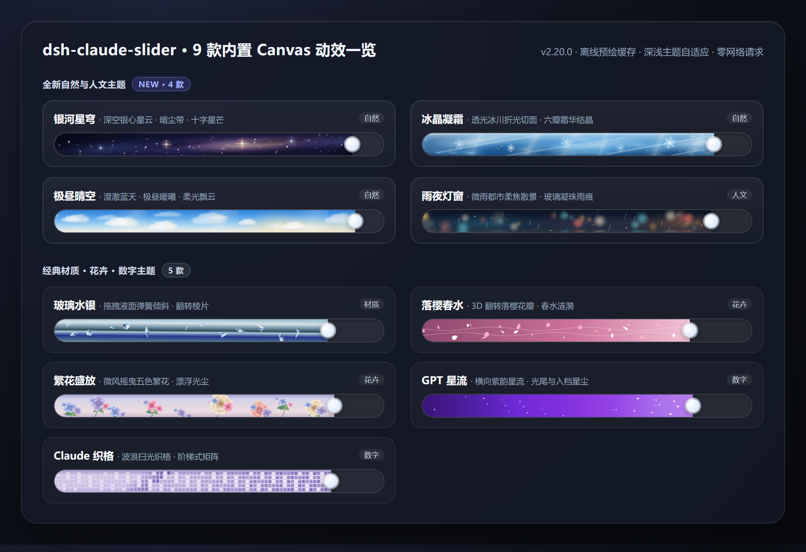
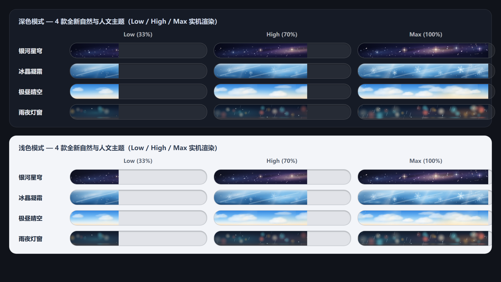
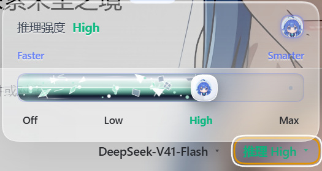
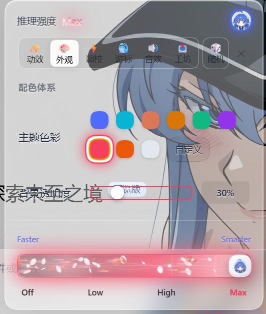
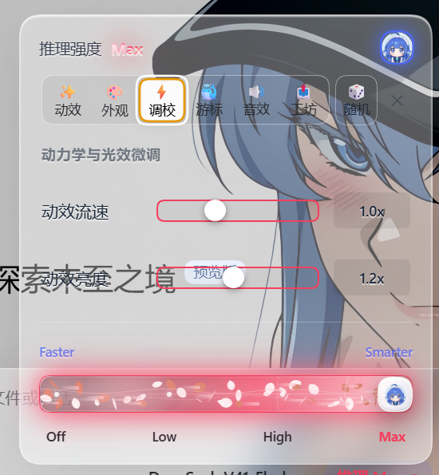
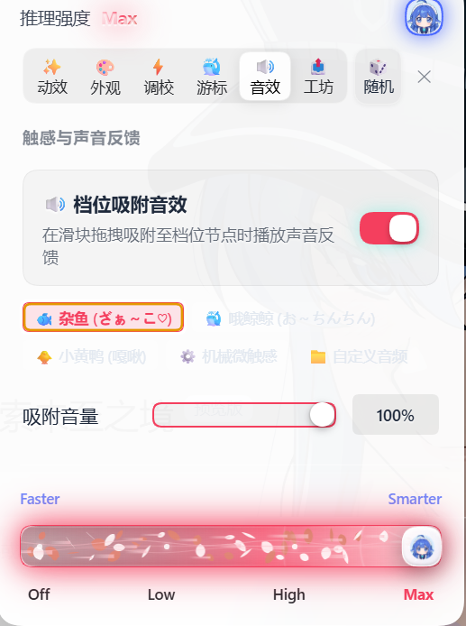
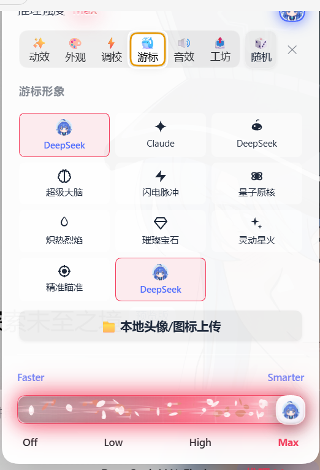

<div align="center">

# dsh-claude-slider

把 DeepSeek Harness 的「推理强度」下拉框，换成一条会呼吸的滑块。


</div>

拖动滑块即可在 Off / Low / Medium / High / Max 之间切换推理强度，并附带液态玻璃面板、9 款 Canvas 动效（涵盖自然、人文、材质、花卉、数字五大主题）、主题配色与吸附音效。

---

## 9 款动效展示

<div align="center">



</div>

### 新增 · 自然与人文主题（v2.20.0）

| 动效 | 分类 | 视觉意境与色彩过渡 | 档位递进（Low → High → Max） |
| :--- | :---: | :--- | :--- |
| **银河星穹** | 自然 | 深靛夜空斜贯蓝紫至玫瑰香槟色银心星云与暗尘埃裂带 | 疏落星海 → 柔和流星轻掠 → 银心呼吸辉光与十字亮星、星尘入档 |
| **冰晶凝霜** | 自然 | 整条轨道雕琢为透光冰川水晶，冷白逆光过渡至冰川天青与深钴蓝冰底，内含天然冰裂晶脉与微气泡 | 静谧冰层折光 → 斜向折光切面滑行、六瓣霜花绽放 → 霜雾漫流、钻石冰尘与瞬冻波纹 |
| **极昼晴空** | 自然 | 高纬度澄澈天蓝过渡至冰青浅空与暖金极昼地平线，柔光双层视差积云悠然漂移 | 晴空微云 → 柔边羽化丁达尔日光束 → 极昼低日呼吸增亮与冰晶日晕微光 |
| **雨夜灯窗** | 人文 | 电影感深青蓝至暖琥珀微雨车窗夜色，四色柔焦街灯散景光斑与路面水光倒影 | 静谧散景与玻璃凝珠 → 纤细斜雨丝滑落玻璃 → 暖冷灯火光海与光晕涟漪 |

<details>
<summary>展开查看：4 款新主题深浅模式 Low / High / Max 三阶递进对比</summary>

<div align="center">



</div>

</details>

---

## 界面实拍

<div align="center">



</div>

| 外观 · 配色与透明度 | 调校 · 流速与亮度 |
| :---: | :---: |
|  |  |
| **音效 · 吸附反馈** | **图标 · 形象选择** |
|  |  |

---

## 安装

```bash
# 桌面版（npm）
dsh plugin --profile desktop add dsh-claude-slider

# 网页版（npm）
dsh plugin --profile web add dsh-claude-slider

# 直接从 GitHub 安装
dsh plugin --profile desktop add github:yicun0316/dsh-claude-slider
```

装完在 DSH 客户端按 <kbd>Ctrl</kbd> + <kbd>R</kbd> 重新加载即可。

<details>
<summary>其他安装方式</summary>

**插件市场**：先装 `dshmarket`，再在界面内搜索 `dsh-claude-slider` 一键安装。

```bash
dsh plugin --profile desktop add dshmarket
```

**本地源码挂载**：克隆仓库 → 运行根目录 `install.bat`（自动软链接到 DSH 插件目录）→ `Ctrl + R`。
打开 `demo/index.html` 可离线预览完整功能。

**卸载**

```bash
dsh plugin --profile desktop remove dsh-claude-slider
```

</details>

---

## 特性

**滑块交互**　「直接拖」连续跟手，松手弹性吸附到最近档位。点击轨道节点直达，随时可关闭并还原为 DSH 原生下拉菜单。

**Q 版图标动效**　v2.17.0 起只留两档：**静止**（只跟随档位）与**呼吸**（3.6s 一个来回，上下 0.9px + 1.8% 纵向缩放，像胸腔起伏而不是整体缩放），`prefers-reduced-motion` 下自动静止。v2.18.0 起「图标皮肤」（气泡 / 立绘 / 裸核）整档下线：图标不再套底板或边框，只按形象本身显示。

**9 款动效**　保留玻璃水银、落樱春水、GPT 星流、Claude 织格、繁花盛放，并新增四款自然与人文主题：**银河星穹**（深空银心星云与十字星芒）、**冰晶凝霜**（透光冰川折光切面与六瓣霜华结晶）、**极昼晴空**（蓝天暖曦地平线与蓬松飘云日光）以及**雨夜灯窗**（微雨都市柔焦灯火散景与玻璃凝珠）。

GPT 星流由深紫渐变至浅紫，Low 有疏落星点，High 追加短光尾，Max 入档时在游标附近散开一簇星尘。玻璃水银的棱面玻璃片会翻转，液面随拖动倾斜并在松手后回摆。

**液态玻璃外观**　磨砂玻璃抽屉的背景透明度可在 10% ~ 100% 之间调节。9 款预设主题色和 Hex 拾色器可更改界面、玻璃水银反光和落樱春水的底色。

**三轴调校**　流速、亮度、音量实时生效，一键复位。

**吸附音效**　杂鱼、哦鲸鲸、小黄鸭、机械微触感四款内置音，支持上传本地 MP3 / WAV（`assets/sounds/` 下可试听 `zako.mp3`、`ochinchin.mp3`）。

**图标形象**　5 款内置（DeepSeek 鲸鱼娘、爱弥斯 朝右、Q 版 白发 / Q 版 蓝发 / Q 版 双马尾），也可上传 PNG / JPG / SVG 或直接填 Emoji。「爱弥斯」与三枚 Q 版自带抠好的全身图（透明底、无文字），选中后直接以那张图站在轨道上；图标格子里也直接画整幅人物，不再显示名字（复刻 README 首图效果）；鲸鱼娘等圆形形象则显示圆形头像。

**游标尺寸规范**　手柄盒固定 28×28，**圆头档圆心压轨道中线、立绘角色脚底踩轨道下沿**，两档各自锚定：

| 档位 | 触发条件 | 手柄内尺寸 | 对齐 |
| :--- | :--- | :--- | :--- |
| 圆头档 | 内置头像（鲸鱼娘 / 爱弥斯圆头像）、Emoji、上传的横图或方图 | 直径 **26px**，圆形裁切 | 圆心 = 中线 |
| 立绘档 |「爱弥斯」的全身立绘、上传的竖长图 | **64px 高**（等比，约 47px 宽） | 脚底 = 轨道下沿 |

上传图片不用自己量：保存时**整张图等比缩放（长边 ≤ 192px），不再预先裁切**，手柄里怎么显示交给档位——圆头档用 `object-fit:cover` 现裁成圆形，立绘档整图等比 64px 高、脚踩轨道下沿。默认按宽高比自动归档（宽高比 < 0.8 视为立绘），传完不舒服可以在「🖼️ 图标 → 上传图尺寸」里随时切「立绘（大）/ 圆头（小）」，切换是无损的。上传图在图标网格里也占一个正常大小的格子（立绘 72px / 圆头 38px），和内置形象并排可选。

---

## 调校参数

| 参数 | 范围 | 默认 |
| :--- | :--- | :--- |
| 背景透明度 | 10% ~ 100% | 85% |
| 动效流速 | 0.5x ~ 2.0x | 1.0x |
| 动效亮度 | 0.5x ~ 2.0x | 1.0x |
| 吸附音量 | 0% ~ 100% | 100% |

外观相关项（`thumbAnim` / `thumbSkin`）在抽屉的「🖼️ 图标」页调整，同样保存在同一
`localStorage` 键下。

> v2.15.0 起「🏃 拖拽」与「🧠 思考」两页整体下线：拖拽固定为直接拖（吸附换档、惯性
> 倾斜 / 刹车趔趄、思考指示器注入均已移除），旧配置里的 `dragMode` / `thumbInertia` /
> `think*` 键仅在读取时被归一化为固定值，不再影响表现。

> 所有动画循环（Canvas 粒子引擎、图标物理骨架）都遵守 `prefers-reduced-motion`，
> 并在页面不可见（`visibilitychange` → `hidden`）时停掉 `requestAnimationFrame`，
> 恢复可见后自动续跑；隐藏期间不产生任何逐帧计算。

---

## 目录结构

```
dsh-claude-slider/
├── package.json          # 插件信息与版本
├── cordis.patch.yml      # DSH 插槽声明
├── lib/
│   ├── index.js          # 服务端入口
│   └── client.js         # 客户端核心实现
├── assets/               # 面板截图、实机图、音频
├── demo/index.html       # 离线预览页
└── install.bat           # 本地软链接安装
```

配置保存在 `localStorage` 键 `dsh-claude-slider.config.v2`，插件零网络请求、不读写用户文件。

---

## 许可

[MIT](LICENSE) © yicun0316
