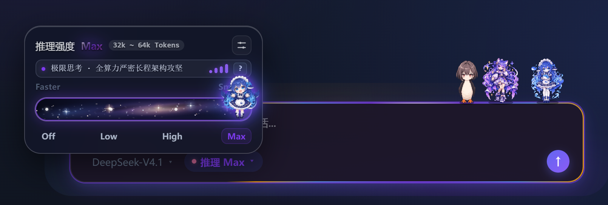
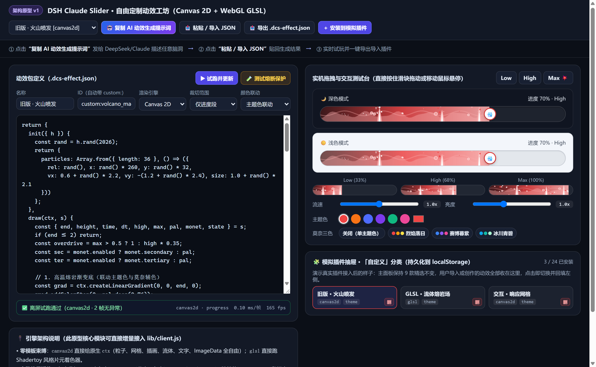
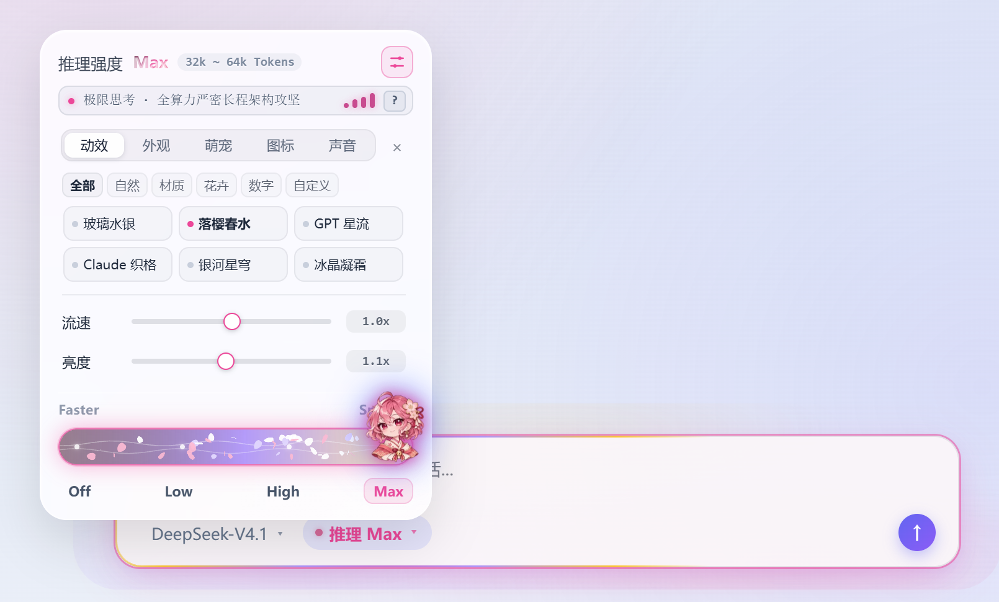
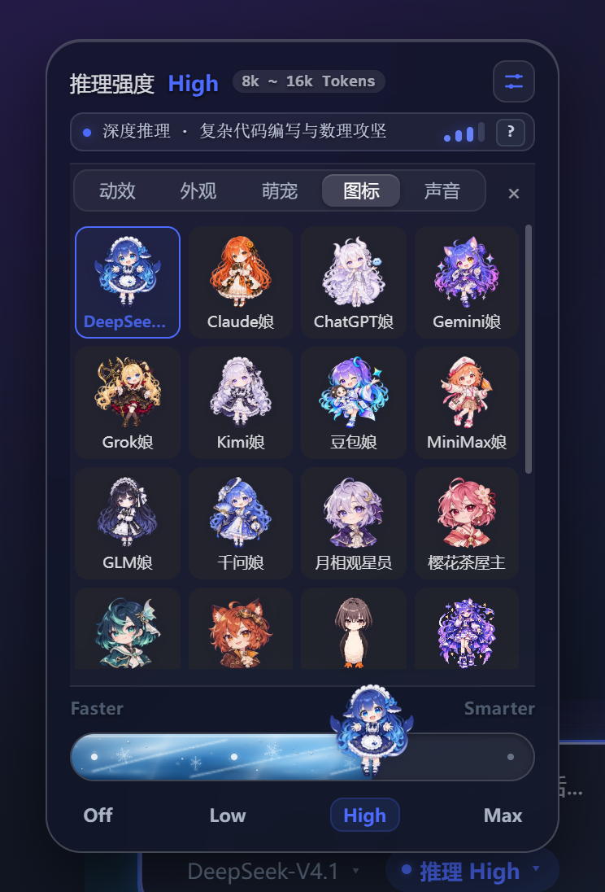

<div align="center">

# dsh-claude-slider

**把 DeepSeek Harness（DSH）的原生「推理强度」下拉框升级为丝滑物理滑块、动效画布、输入框萌宠剧场与莫奈光效套件。**

[](package.json)
[](https://dsh-plugin.org/plugins/yicun0316/dsh-claude-slider)
[](LICENSE)
[](https://yicun0316.github.io/dsh-claude-slider/studio/)
[](https://yicun0316.github.io/dsh-claude-slider/demo/)
[](#隐私与性能护栏)

[在线交互演示](https://yicun0316.github.io/dsh-claude-slider/demo/) · [自由定制动效工坊](https://yicun0316.github.io/dsh-claude-slider/studio/) · [16 款扩展动效库](themes/README.md) · [插件市场页面](https://dsh-plugin.org/plugins/yicun0316/dsh-claude-slider)

<br />



</div>

---

`dsh-claude-slider` 是一款面向 **DeepSeek Harness（DSH）桌面端与网页端** 的零构建单文件插件。在替代原生静态下拉菜单的基础上，内置欠阻尼物理换档引擎、多款 Canvas 动效、Canvas 2D / WebGL GLSL 自定义动效运行时、输入框像素萌宠剧场、多款角色与萌宠游标、莫奈三色流光框及档位音效。

> [!TIP]
> **无需安装 DSH 即可抢先体验**：直接打开 [**在线交互演示（Demo）**](https://yicun0316.github.io/dsh-claude-slider/demo/) 试玩完整滑块、萌宠与外观面板，或打开仓库本地的 [`demo/index.html`](demo/index.html)。

---

## 快速安装

在终端执行以下命令之一即可安装：

```bash
# 桌面版（npm 稳定版）
dsh plugin --profile desktop add dsh-claude-slider

# 桌面版（GitHub 最新版）
dsh plugin --profile desktop add github:yicun0316/dsh-claude-slider

# 网页版
dsh plugin --profile web add dsh-claude-slider
```

安装完成后在 DSH 客户端内按 <kbd>Ctrl</kbd> + <kbd>R</kbd> 刷新界面即可启用。如需还原回原生下拉框，可在面板开关中关闭或随时卸载。

<details>
<summary>插件市场安装 / 本地源码挂载 / 卸载命令</summary>

**通过 DSH 插件市场安装**

```bash
dsh plugin --profile desktop add dshmarket
```

安装 `dshmarket` 后在插件市场搜索 `dsh-claude-slider` 点击安装即可。

**本地源码挂载（适合二次开发）**

将仓库克隆到本地后，运行根目录的 [`install.bat`](install.bat) 建立软链接；修改 [`lib/client.js`](lib/client.js) 后在 DSH 中按 <kbd>Ctrl</kbd> + <kbd>R</kbd> 即可热生效。

**卸载插件**

```bash
dsh plugin --profile desktop remove dsh-claude-slider
```

</details>

---

## 核心特性

### 1. 丝滑换档引擎与键盘流操控

- **物理同帧渲染**：游标、Canvas 前沿进度与跟随悬浮 HUD 统一由单一 `requestAnimationFrame` 时钟驱动，通过 GPU 合成层 `translate3d` 像素级同步；配合欠阻尼弹簧回弹、速度挤压拉伸与乐观档位锁，快速连点与拖拽顺滑无回弹。
- **高效交互与遥测条**：支持直接拖拽、点击刻度、轨道滚轮微调、`Shift + 点击` 触发胶囊快切；顶部单行紧凑遥测条实时显示档位释义与算力能量格。
- **全键盘流快捷键**：支持 <kbd>←</kbd>/<kbd>→</kbd>（或 <kbd>H</kbd>/<kbd>L</kbd>）切档、<kbd>1</kbd>–<kbd>4</kbd> 直达档位、<kbd>Home</kbd>/<kbd>End</kbd> 跳转首尾、<kbd>D</kbd> 开关定制抽屉、<kbd>[</kbd>/<kbd>]</kbd> 切换页签、<kbd>?</kbd> 展开速查条、<kbd>Esc</kbd> 分层收起。

### 2. 多款内置动效与分类

所有内置动效均按推理档位（`Off / Low / High / Max`）逐级叠加粒子与光效细节，流速支持调节至 `0x`（静态定格）：

| 分类 | 动效名称 | 视觉与交互表现 |
| :--- | :--- | :--- |
| **自然** | **银河星穹** | 深蓝紫夜空斜贯银心星云带与尘埃裂带，High 档偶发流星，Max 档游标绽放星尘 |
| **自然** | **冰晶凝霜** | 整条轨道化作背光冰川水晶，斜向折光面缓缓滑过，随档位展开六瓣霜花与霜雾 |
| **材质** | **玻璃水银** | 液面随拖拽手速倾斜、松手阻尼回摆，内含三种翻转反光玻璃棱片 |
| **花卉** | **落樱春水** | 花瓣随春水涟漪翻滚飘落，底色自动联动主题色与莫奈三色盘 |
| **数字** | **GPT 星流** | 紫调渐变底色配柔光星点，高档位拖出光尾与入档粒子 |
| **数字** | **Claude 织格** | 逐格扫过的波浪方块矩阵，兼具节奏感与克制光效 |

### 3. 自定义动效生态与在线工坊（Studio）

插件抽屉「动效 → **全部**」汇总内置与已导入动效，「动效 → **自定义**」支持导入、复制分享与删除 `.dcs-effect.json` 动效包。运行时原生支持 **Canvas 2D** 与 **WebGL GLSL** 双引擎，提供离屏试跑校验与连续异常自动熔断保护。

- **在线自由定制工坊**：[**立即打开 Studio 在线工坊**](https://yicun0316.github.io/dsh-claude-slider/studio/)（或双击本地单文件 [`studio/index.html`](studio/index.html)）：
  1. **创作或让 AI 生成**：从内置模板起步、直接编写 Canvas 2D / WebGL GLSL 代码，或点击 **「复制 AI 动效生成提示词」** 发给 DeepSeek / Claude 按协议生成；
  2. **双模式实时调试**：在深色 / 浅色双滑块上拖拽实测 `Low / High / Max` 三档表现、流速（`0x ~ 2.0x`）与莫奈三色盘联动，工坊会实时执行离屏校验与报错拦截；
  3. **一键导入插件**：点击 **「导出 .dcs-effect.json」** 或 **「复制 JSON」**，回到 DSH 插件面板 **「动效 → 自定义 → 导入文件 / 粘贴导入」** 即可立即生效。
- **16 款现成动效库**：仓库 [`themes/`](themes/README.md) 目录收录了 16 款可独立导入的动效包（含旧版火山喷发、极光织锦、GLSL 流体熔岩、铜银金砂等），不占主包体积，按需导入。

<div align="center">



</div>

### 4. 输入框像素萌宠剧场

<div align="center">


</div>

在输入框顶部饲养可多只同屏互动的像素伙伴，支持自由挑选并发出场，支持 **右上 / 左上 / 分站** 站位与 `0.8x ~ 1.35x` 尺寸调节：

- **6 只内置小伙伴**：**臭企鹅**（高松灯，含递进「咕咕嘎嘎」与《春日影》彩蛋）、**反重力猫娘**、**鲸鱼娘女仆**，以及 **小紫猫**、**暖橘小蟹**、**深海小鲸**。
- **生态互动**：平时会在输入框顶部自主散步、相遇打闹（可在面板单独关闭）；支持鼠标戳一戳或拎起拖动触发不同台词。
- **状态联动**：模型开始思考时会被「推理风」吹拂晃动，回答完成后会集体跳跃撒花庆祝。

### 5. 外观、20 款游标与反馈音效

点击滑块右上角按钮展开 **5 页签设置面板**（动效 / 外观 / 萌宠 / 图标 / 声音）：

- **外观与莫奈色盘**：内置 8 个常用主色、Hex 拾色器、浅色玻璃 / 深色磨砂 / 跟随系统三种质感与 `15% ~ 100%` 面板透明度；提供 6 组莫奈三色盘（反重力星紫、莫奈睡莲、樱云薄雾、晨曦琥珀、碧水青瓷、深海鲸蓝）及输入框 **全周随鼠流光框**（棱镜虹彩 / 莫奈色盘）与环境晕色。
- **20 款内置游标 & 自定义裁边**：
  - 10 款 AI 拟人娘（`DeepSeek娘`、`Claude娘`、`ChatGPT娘`、`Gemini娘`、`Grok娘`、`Kimi娘`、`豆包娘`、`MiniMax娘`、`GLM娘`、`千问娘`）
  - 4 款原创 Q 版（`月相观星员`、`樱花茶屋主`、`海玻璃信使`、`琥珀狐机械师`）
  - 5 款像素萌宠（`臭企鹅`、`反重力猫娘`、`小紫猫`、`暖橘小蟹`、`深海小鲸`）+ 1 款 `极简纯白`
  - 支持上传本地 PNG / JPG / SVG 图片，内置自动紧裁透明边与无损切换 **立绘档** / **圆头档**（`70% ~ 140%` 缩放）。
- **档位音效**：内置 5 款反馈音（**机械微触**、**咕咕嘎嘎**、**杂鱼**、**哦鲸鲸**、**小黄鸭**，[`assets/sounds/`](assets/sounds/) 中存有音频素材），支持上传本地 MP3 / WAV 与独立音量调节。

| 浅色液态玻璃与动效分类 | 20 款角色与像素萌宠游标 |
| :---: | :---: |
|  |  |

---

## 隐私与性能护栏

> [!NOTE]
> - **零网络请求与零文件读取**：所有设置仅保存在浏览器本地 `localStorage`（主配置键 `dsh-claude-slider.config.v2`，自定义动效键 `dsh-claude-slider.custom-effects.v1`），插件运行时不发起任何外部网络请求。
> - **按需渲染节能**：页面切入后台或最小化、滑块置于 `Off` 档、流速设为 `0x` 或系统启用「减少动态效果」时，动画循环自动停帧。

---

## 目录结构

```text
dsh-claude-slider/
├── .github/workflows/    # GitHub Pages 部署与 npm OIDC 自动发布工作流
├── package.json          # 插件元信息与 DSH 注入声明
├── cordis.patch.yml      # Cordis 插槽补丁配置
├── lib/
│   ├── index.js          # 服务端插件入口
│   └── client.js         # 客户端单文件核心实现（零构建直跑）
├── studio/index.html     # 自由定制动效工坊（Canvas 2D + WebGL GLSL + AI 提示词）
├── demo/index.html       # 离线交互预览页
├── themes/               # 16 款可独立导入的 .dcs-effect.json 动效库
├── assets/               # 展示图片与内置音效资源
├── scripts/              # 语法与未声明标识符检查脚本
└── install.bat           # Windows 一键本地源码软链脚本
```

---

## 开源致谢与灵感参考

本项目在光学界面质感、流光边框、滑块手感和萌宠生态设计上深受社区优秀开源项目启发，特此致谢：

| 项目 | 作者 / 协议 | 参考与致谢说明 |
| :--- | :---: | :--- |
| [**RMvdesi/obsidian-prism**](https://github.com/RMvdesi/obsidian-prism) | RMvdesi · `GPL-3.0-only` | 液态玻璃质感、输入框流光框、莫奈氛围与像素萌宠玩法启发 |
| [**0DNANCY/agy-claude-style**](https://github.com/0DNANCY/agy-claude-style) | 0DNANCY · `MIT` | 光学界面风格、柔和动效节奏与像素伙伴骨架灵感 |
| [**Nwflower/dsh-claude-style**](https://github.com/Nwflower/dsh-claude-style) | Nwflower | DSH Claude 风格的极简输入框与排版思路 |
| [**Microqian2th/dsh-codex-effort-slider**](https://github.com/Microqian2th/dsh-codex-effort-slider) | Microqian2th | DSH 推理强度滑块、能量轨道与阻尼手感的上游启发 |
| [**mobius/dsh-performance-slider**](https://github.com/mobius/dsh-performance-slider) | mobius | 性能档位滑块交互与反馈思路参考 |
| [**LLYSH-HANNARI/antigravity-Codex-Claude-effort-slider**](https://github.com/LLYSH-HANNARI/antigravity-Codex-Claude-effort-slider) | 月上寒 · `MIT` | 推理等级滑条交互设计参考 |
| [**claudenoshujin/claude-web**](https://github.com/claudenoshujin/claude-web) | lulu | 萌宠叠叠乐与微生态互动灵感（本插件为独立实现） |

同时致谢 Obsidian Prism 上游生态中的开源项目：[**ATtacK030130/antigrative-dashboard**](https://github.com/ATtacK030130/antigrative-dashboard)（`MIT` · AG Pulse）与 [**yiheng8023/antigravity-chinese**](https://github.com/yiheng8023/antigravity-chinese)（`MIT` · yiheng8023）。

---

## 开源协议

本项目代码为独立实现，基于 [MIT License](LICENSE) 开源 © [yicun0316](https://github.com/yicun0316)。引用或二次修改时请同样保留对以上开源社区项目的致谢。
